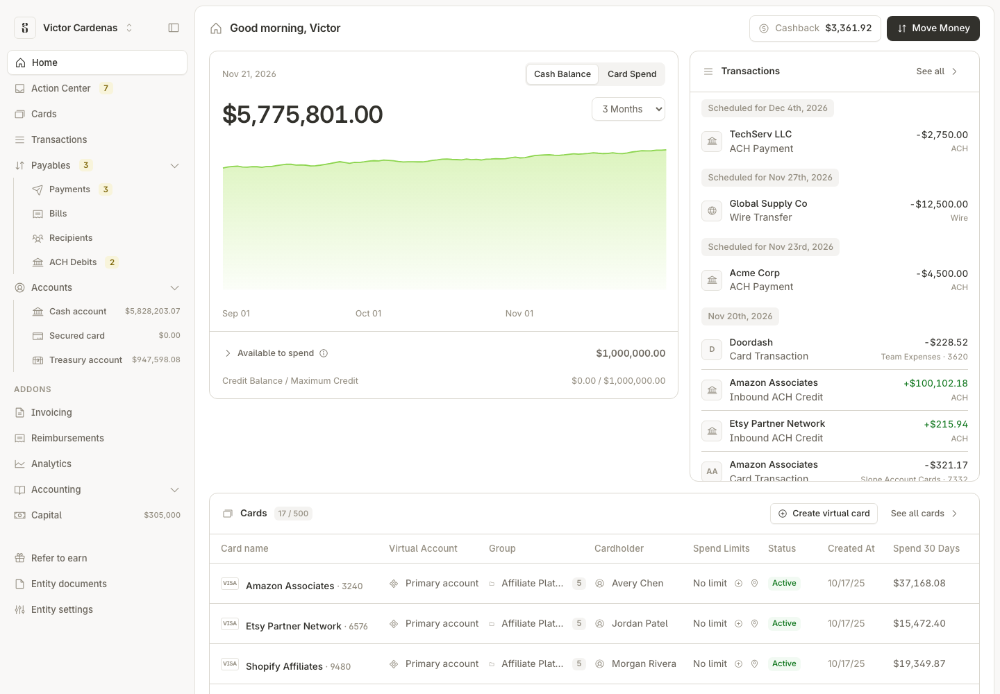
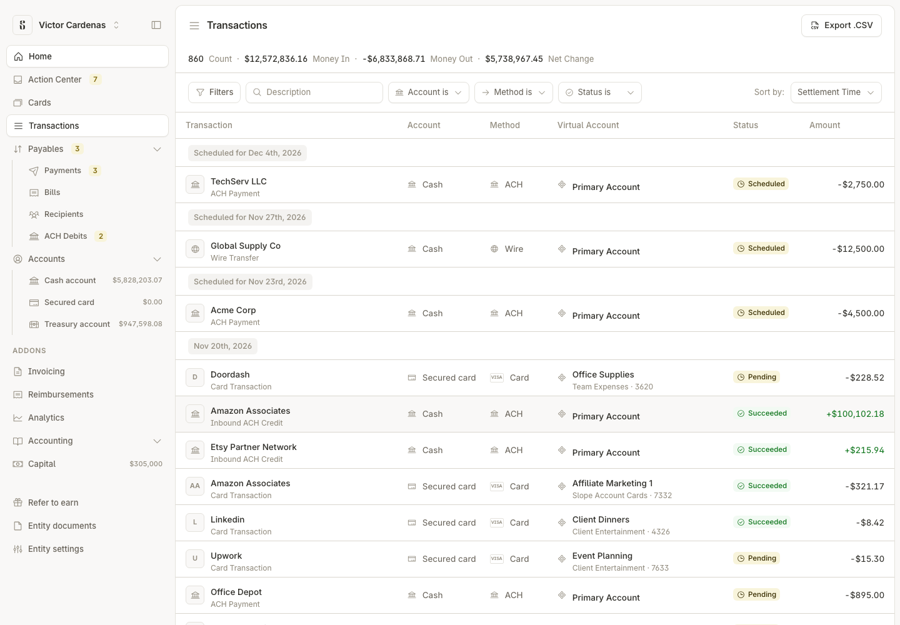
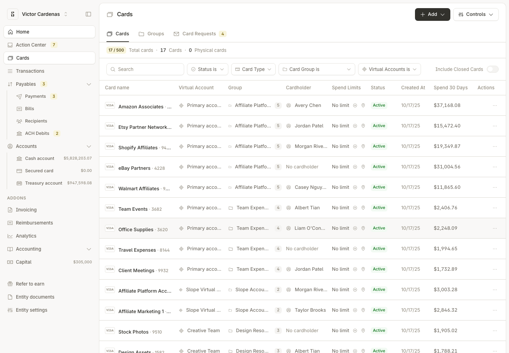
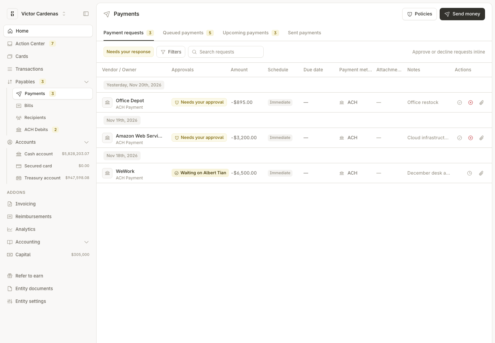
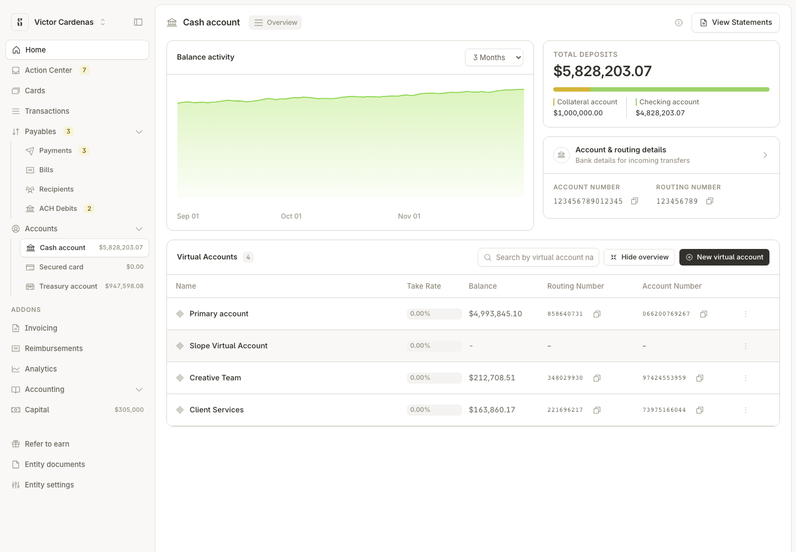
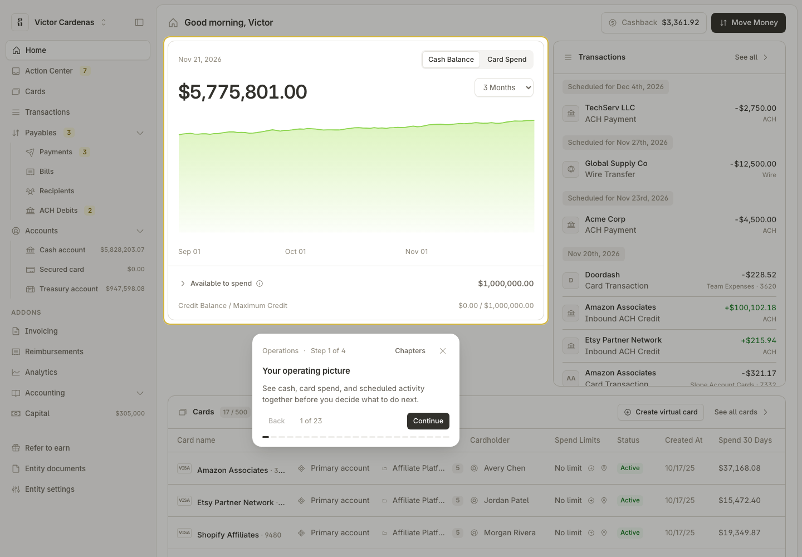
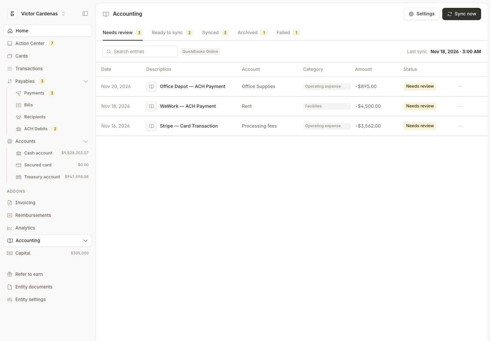

# slash-web

A complete, fully interactive replica of the **Slash** banking dashboard demo — `https://demo.slash.com/platinum`.

Not a screenshot gallery and not a static mock: the 23-step product tour, every navigation entry, and every business flow (approvals, cards, payments, spend controls, accounts, analytics, accounting) are implemented and behave the way the original does.



---

## Highlights

- **Pixel-faithful design system** — the product's own compiled Tailwind v4 token layer (2 141 CSS variables, `oklch` palette) is reused verbatim, together with all 29 webfonts, so typography, radii and colour match exactly. Light and dark themes both work.
- **The full 23-step guided tour** — welcome modal, chaptered walkthrough with spotlight cut-outs, progress bar, chapter jump menu, and the "Product tour complete" end screen.
- **21 screens, all functional** — every button changes real state: create a virtual card, approve a payment, capture and pay a bill, send an invoice, approve an expense, authorise an ACH debit, draw capital, sync accounting entries, move money, invite a user, issue an API key.
- **Real demo data** — the actual values from the live demo (860 transactions totalling $12,572,836.16 in / $5,738,967.45 net, 17 cards, $5,828,203.07 cash, $305,000 capital drawn, 8 bills, 8 invoices, 12 expenses, 15 recipients).
- **Zero backend required** — state lives in a typed reducer persisted to `localStorage`; *Reset demo data* restores the pristine seed.

## Quick start

```bash
pnpm install
pnpm dev        # → http://localhost:5173/platinum
```

Build & preview the production bundle:

```bash
pnpm build
pnpm preview    # → http://localhost:4173/platinum
```

Requires Node 18+ and pnpm 8+.

> On first load the app shows the **Welcome to Slash** modal — start the guided tour or skip straight into the console.

## Documentation

| Document | Contents |
| --- | --- |
| [docs/FEATURES.md](docs/FEATURES.md) | Every screen and every interaction, page by page |
| [docs/ARCHITECTURE.md](docs/ARCHITECTURE.md) | How the replica was reverse-engineered, the token system, state model, tour engine |
| [docs/DEPLOYMENT.md](docs/DEPLOYMENT.md) | Cloudflare Pages, Netlify, Vercel, Nginx, GitHub Pages |
| [docs/CONTRIBUTING.md](docs/CONTRIBUTING.md) | Dev setup, conventions, how to add a page or a tour step |

## Feature map

| Area | Screens |
| --- | --- |
| Operations | Home · Action Center · Transactions |
| Cards & Controls | Cards (Cards / Groups / Requests) · Policies |
| Payments | Payments · Bills · Recipients · ACH Debits |
| Billing | Invoicing (one-off / recurring) · Reimbursements |
| Cash | Cash account · Secured card · Treasury · Capital |
| Intelligence | Analytics · Accounting · Accounting · Bills · Accounting settings |
| Add-ons | Wallets · Documents · Refer to earn |
| Settings | Business details · Users · Security · Policies · API management · Activity log |
| Global | Move Money · 23-step tour · theme switch · entity menu · toasts |

## Screens

| | |
| --- | --- |
|  |  |
|  |  |
|  |  |

## Tech stack

| Layer | Choice | Why |
| --- | --- | --- |
| Build | Vite 5 | instant HMR, trivial static output |
| UI | React 18 + TypeScript | component model matching the original DOM structure |
| Routing | React Router 6 | 1:1 mirror of the product's route map |
| Icons | Phosphor + extracted SVGs | same icon system as the original |
| Charts | hand-written SVG | no chart dependency; exact match to the source visuals |
| State | React context + reducer | 40+ named business actions, `localStorage` persistence |

## Project layout

```
src/
  styles/app.css        component layer built on the product tokens
  styles/slash*.css     product token + utility stylesheets
  data/seed.ts          demo data and domain types
  data/icons.json       extracted SVG icon bodies
  store/index.tsx       global state, business actions, persistence
  components/ui.tsx     buttons, tabs, tables, modals, drawers, menus, charts
  components/shell.tsx  sidebar, entity menu, toasts, settings navigation
  tour/Tour.tsx         23-step tour engine
  pages/                one file per screen
public/
  assets/fonts, build/fonts   29 webfonts, paths identical to the original
  _redirects, _headers        SPA routing + cache policy
docs/                   documentation and reference screenshots
```

## Deployment

Static output → Cloudflare Pages (or Netlify / Vercel / Nginx).

```bash
pnpm build
export CLOUDFLARE_API_TOKEN="<token>"
export CLOUDFLARE_ACCOUNT_ID="<account id>"
wrangler pages deploy dist --project-name=slash-platinum-demo --branch=main
```

`public/_redirects` already handles SPA fallback for deep links such as `/platinum/cards`. See [docs/DEPLOYMENT.md](docs/DEPLOYMENT.md).

## Credits & licence

Built as an educational replica of the Slash product demo. MIT — see [LICENSE](LICENSE).

The bundled product stylesheet (`src/styles/slash.css`) and webfonts (`public/`) are included solely to reproduce the original interface faithfully and remain the property of their respective owners. All demo data is fictional and generated for this replica.
