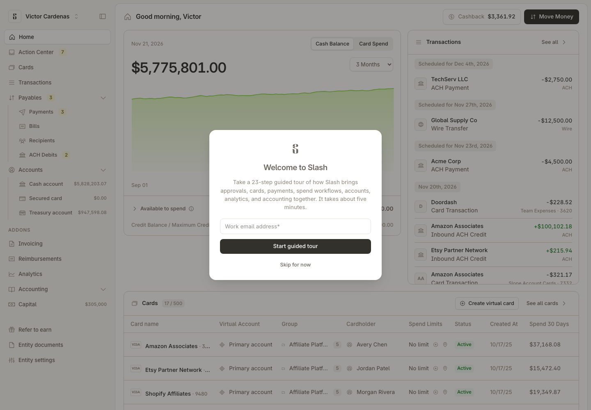
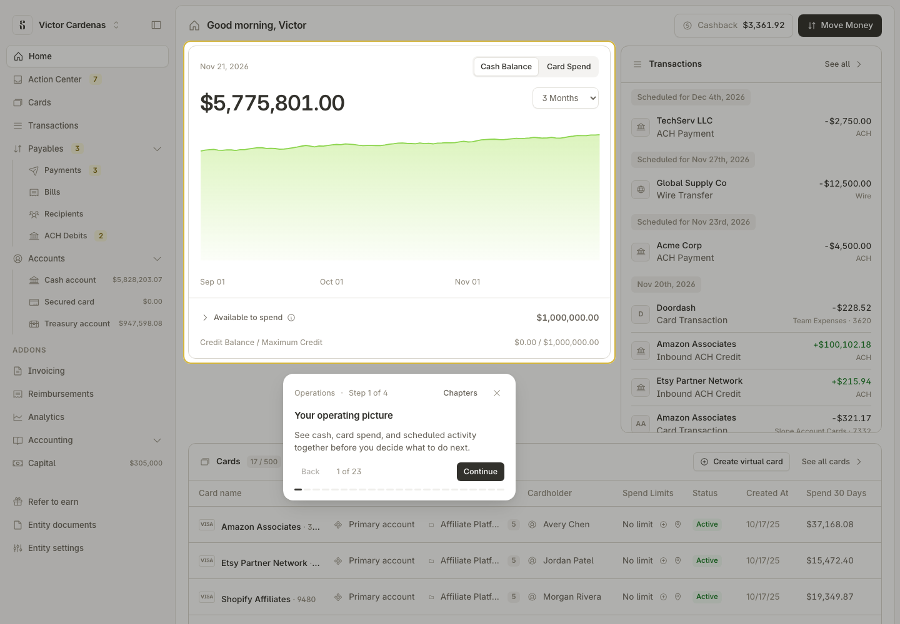
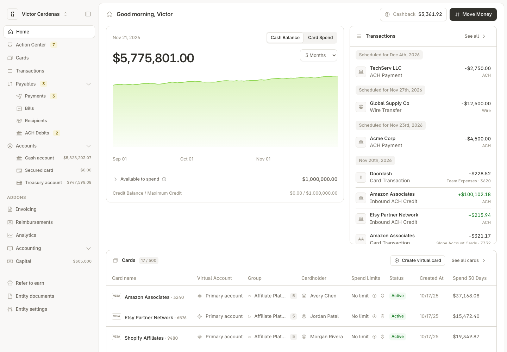
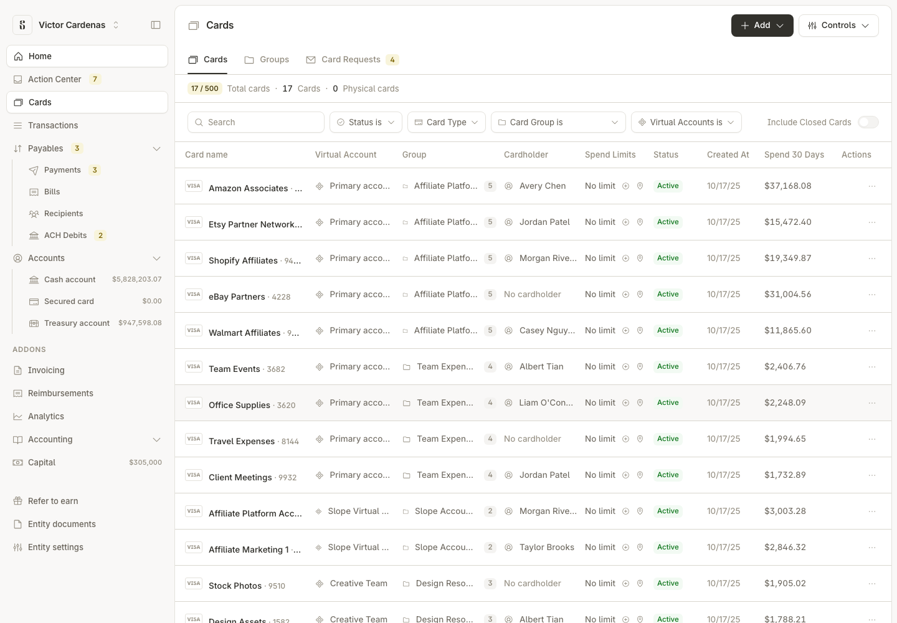
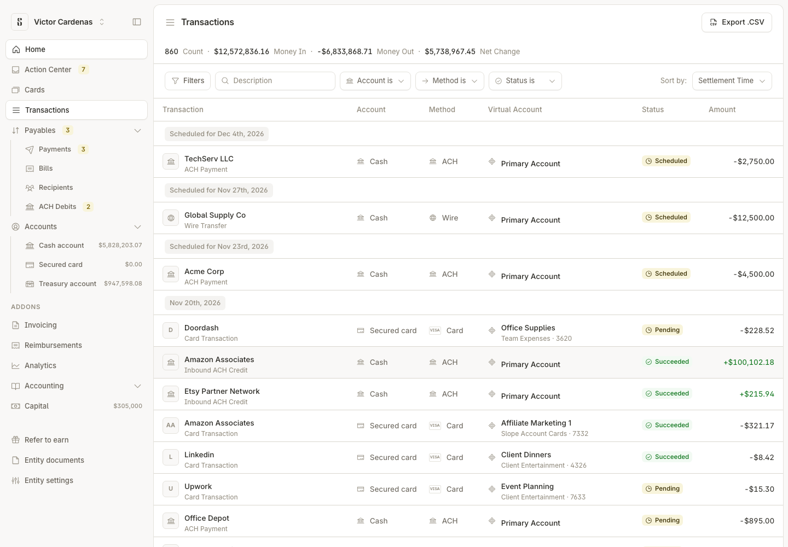
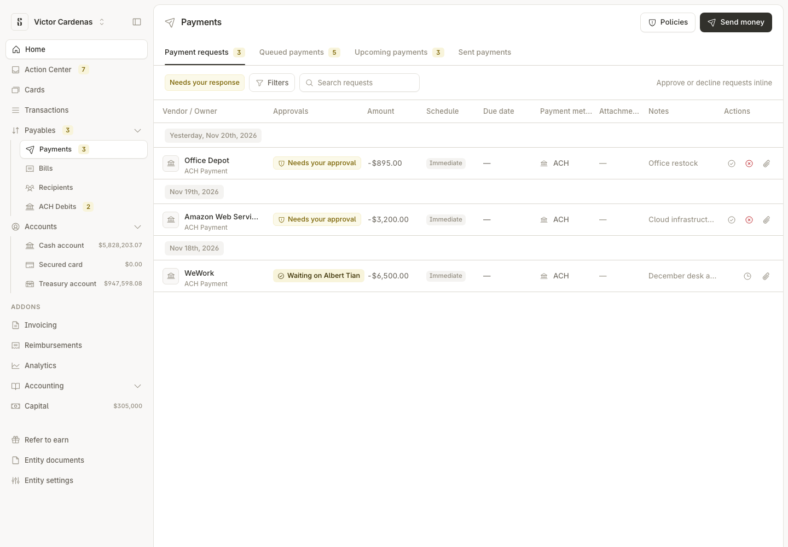
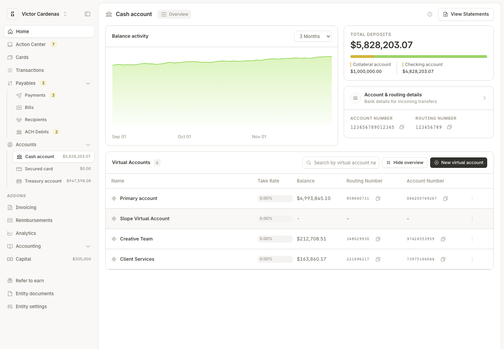
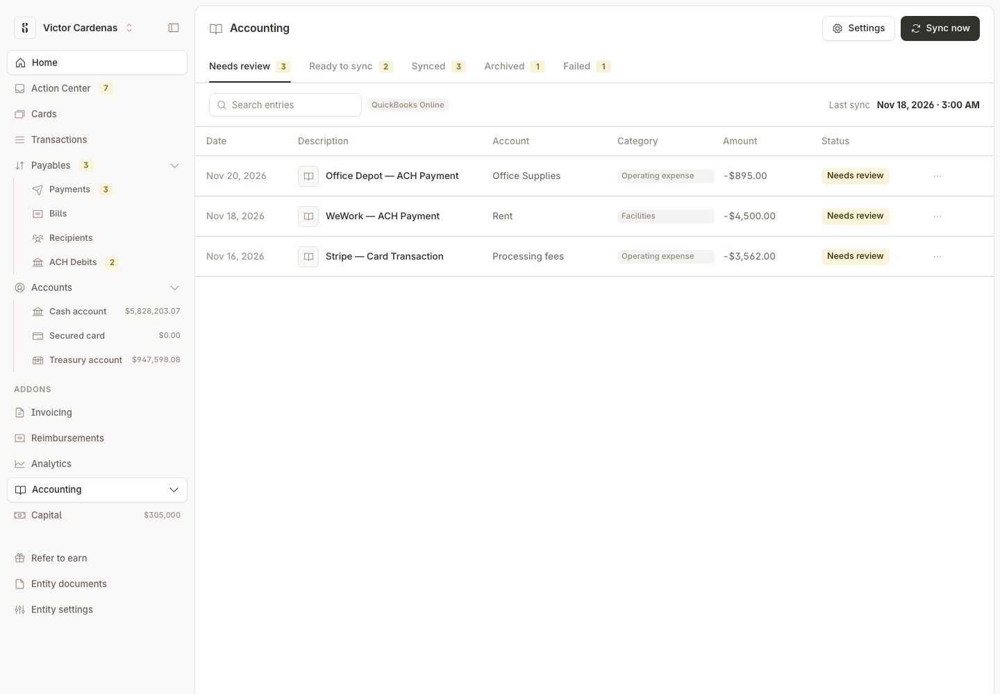

# Feature Reference

Every interactive surface of the replica, page by page. Each entry lists what the page renders and what actually happens when you use it.

Screenshots live in [`docs/screenshots/`](screenshots/).

---

## 0 · Welcome & the 23-step tour

First visit shows the welcome modal: the Slash mark, the 23-step pitch, a work-email field, **Start guided tour** and **Skip for now**.

Starting the tour walks all 23 steps across 7 chapters, auto-navigating to each target route and spotlighting the relevant region with a cut-out highlight:

| # | Chapter | Step | Target |
| --- | --- | --- | --- |
| 1–4 | Operations | operating picture · find a transaction · one decision queue · review a request | `/platinum`, `/transactions`, `/action-center` |
| 5–7 | Cards & Controls | cards for every spend · full card lifecycle · controls before spend | `/cards`, `/settings/policies` |
| 8–11 | Payments | send money with policy controls · payment lanes · queued review · incoming ACH | `/payments`, `/payments/ach-authorizations` |
| 12–15 | Bills, Invoicing & Reimbursements | bills → approved payments · repeatable invoices · invoice outcomes · expenses with receipts | `/payments/bills`, `/invoices`, `/reimbursements` |
| 16–18 | Cash, Treasury & Capital | cash & routing details · move treasury funds · capital position | `/account/cash`, `/treasury`, `/account/capital` |
| 19 | Analytics | break down spend activity | `/analytics/reports/general-analytics` |
| 20–23 | Accounting | accounting status · code bills · manage connection · map card activity | `/accounting`, `/accounting/bills`, `/accounting/settings/*` |

The tour card supports **Back / Continue / Chapters** (jump to any chapter), a 23-segment progress bar, and a close button. On the last step it becomes the **Product tour complete** screen (*Talk to sales / Keep exploring / Replay tour*). Replay is also available from the entity menu.

---

## 1 · Home

- **Header** — “Good morning, Victor”, Cashback balance pill, **Move Money** button.
- **Balance card** — date, `Cash Balance / Card Spend` toggle, headline figure, range selector (3/6/12 months, YTD), interactive area chart with crosshair + tooltip, **Available to spend**, **Credit Balance / Maximum Credit**.
- **Transactions panel** — scheduled items first (`Scheduled for Dec 4th, 2026` …), then the latest activity with method + card-group metadata, `See all` deep-link.
- **Cards panel** — `17 / 500` counter, **Create virtual card**, **See all cards**, and the full card table (name, virtual account, group + count, cardholder, spend limits, status, created date, 30-day spend).

## 2 · Action Center

- Tabs: **Action required (7) / Pending (2) / Completed (4)**.
- Master–detail: pick a request on the left, read its supporting detail on the right (amount, method, account, schedule, memo, approver).
- **Approve / Decline** write to the audit log; **Open workspace** jumps to the related area (Payments, Reimbursements, Cards, ACH Debits).
- Completed items keep their decision history.

## 3 · Cards

- **Tabs** — Cards · Groups · Card Requests (4).
- **Stats** — `17 / 500` total, 17 cards, 0 physical.
- **Filters** — search, status, card type, card group, virtual account, `Include Closed Cards`.
- **Row actions** — card details, pause/resume, edit spend limit, reassign cardholder, replace card, close card.
- **Create virtual card** — name, cardholder, group, virtual account, spend limit, last four digits; the card appears in the table immediately and in its group count.
- **Groups tab** — group, card count, spend limit, merchant rules, `View cards` (filters the card table to that group).
- **Card Requests tab** — approve (issues the card immediately) or deny.

## 4 · Transactions

- **Totals** — `860 Count · $12,572,836.16 Money In · -$6,833,868.71 Money Out · $5,738,967.45 Net Change`.
- **Filters** — description search, account, method, status, plus sort by Settlement Time / Amount / Description.
- **Rows** — merchant tile, type, account, method, virtual account + card group, status, amount; grouped under date chips.
- **Row click** → detail drawer: amount, date, settlement, account, method, virtual account, card group, status, transaction id and an activity timeline; **Download receipt**, **Dispute**.
- **Export .CSV** — generates and downloads `slash-transactions.csv` for the current filtered set.

## 5 · Payments

- **Tabs** — Payment requests (3) · Queued payments (68) · Upcoming payments (3) · Sent payments.
- Header actions: **Policies** (jumps to payment policies) and **Send money**.
- **Send money** — two-step modal: vendor/recipient, amount, method (ACH / Wire / Check), source account, Immediate or Scheduled + date, memo, attachment; the review step shows the computed approval rule (`> $5,000 ⇒ 2 approvals`) before submitting.
- Inline **approve / decline / send now / remind** actions, attachment count, notes column, row drawer with full payment detail.

## 6 · Bills

- Eight seeded bills covering every status: Draft, Pending approval, Scheduled, Paid, Partially paid, Payment failed.
- Overdue bills show “15 days overdue” in red.
- **New bill** modal (vendor, amount, due date, invoice #, notes, “send for approval immediately”).
- Row actions: Submit, Approve, Pay now, Retry. Drawer shows invoice metadata and the capture → coding → approval trail.

## 7 · Recipients

- 15 recipients with W-9 state (verified / pending request / missing), last payment, total paid.
- **New recipient**, archive toggle, per-row actions: Send money, Request W-9, Copy email, Archive.

## 8 · ACH Debits

- Pending / Decision history tabs, SEC code (WEB/CCD/CTX), effective date, approve or decline, decision history in the drawer.

## 9 · Invoicing

- Invoices / Recurring tabs, `Outstanding` total in the toolbar.
- Status chips: Draft, Sent, Viewed, Paid, Overdue.
- **Create invoice** (save draft or create & send), row actions: send, reminder, mark paid, copy payment link, delete draft; drawer with invoice number, issue date, due date, memo, payment terms, reminder state.
- Recurring tab lists active/paused series with cadence and next invoice date.

## 10 · Reimbursements

- View selector (all / needs review / cancelled / rejected / processing / complete / failed) with live counts.
- Receipt badges (attached count or a red “None” warning), status chips, approve / reject / pay actions, drawer with accounting coding.

## 11 · Cash account

- Balance activity chart, **Total deposits** panel with the collateral / checking split bar, **Account & routing details** with copy buttons, and the **Virtual Accounts** table (take rate, balance, routing + account numbers, copy).
- **New virtual account** opens a real virtual account with generated routing/account numbers.

## 12 · Treasury

- Balance, blended yield, allocation bars per position, positions table (T-Bill / money market / sweep with yield, value, maturity).
- **Transfer funds** moves money between cash and treasury and records an internal transfer transaction.

## 13 · Capital

- Available credit, outstanding balance, utilisation %, APR, next due date, activity table, **Draw funds** → credits the cash account.

## 14 · Analytics

- Dimension switcher: Payment method / Merchant / Contact / Card group.
- Share bars with percentages, breakdown table with amount, share and transaction count, range selector, export.

## 15 · Accounting

- Status tabs: Needs review · Ready to sync · Synced · Archived · Failed.
- **Sync now** promotes reviewable entries to Synced; each entry can also be marked ready, synced or archived individually.
- Entry drawer lets you remap the GL account.
- **Accounting · Bills** — bill-level coding table with dimension chips.
- **Accounting settings**
  - *General* — connected platform (QuickBooks Online), auto-sync toggles, per-feature switches, last sync, manual sync.
  - *Mapping Settings* — source category → GL account mapping editor with entry counts.
  - *Fields* — per-field sync preferences.
  - *Imported data* — imported CSV files with row counts and sync state.
  - *Intelligence* — coding suggestions with match confidence and one-click apply.

## 16 · Wallets

- One card per chain wallet (address, balance, created date), assets table (token, wallet, amount, price, USD, P/L) with totals, **Add wallet**, **Move Crypto** conversion with fee estimate.

## 17 · Documents

- Entity documents grouped by category (Entity / Account statements / Card exports / Tax), type, size, upload date; download & preview actions, **Download all**, **Upload**.

## 18 · Refer to earn

- Referral link with copy/share, invited / qualified / earned / pending metrics, referral history table, invite form.

## 19 · Move Money

- Four modes: **Between accounts / Deposit / Withdraw / Send money**.
- Quick amount chips, memo, live summary, recent activity, success screen; transfers update balances and write a transaction.

## 20 · Settings

| Page | Contents |
| --- | --- |
| Business details | legal name, DBA, EIN, entity type, address, phone, website, industry + verification status |
| Users | invite, role change (Admin / Controller / Bookkeeper / Cardholder), suspend, resend invite, remove |
| Security | 2FA toggle, device approval, active sessions with revoke, alert toggles |
| Policies | Card limits (create, activate, draft), Payment approvals, ACH authorization rules |
| API management | create/revoke keys, scopes, webhook list |
| Activity log | actor, action, target, timestamp |

---

## Global

- **Sidebar** — 280 px, collapsible to 57 px; Home, Action Center (badge), Cards, Transactions, Payables ▸ Payments / Bills / Recipients / ACH Debits, Accounts ▸ Cash / Secured card / Treasury (with balances), ADDONS ▸ Invoicing / Reimbursements / Analytics / Accounting / Capital.
- **Entity menu** — switch entity, entity settings, users, replay tour, light/dark theme, reset demo data.
- **Toasts**, modals, right-hand drawers, dropdown menus, empty states, confirmations.
- **Persistence** — every change is stored in `localStorage` and survives reload; *Reset demo data* restores the seed.
